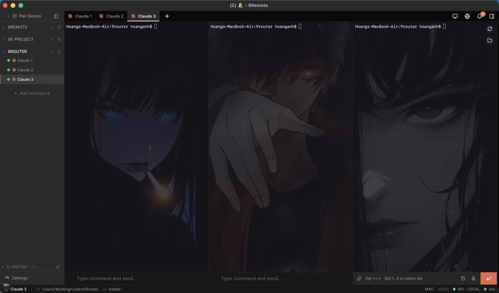
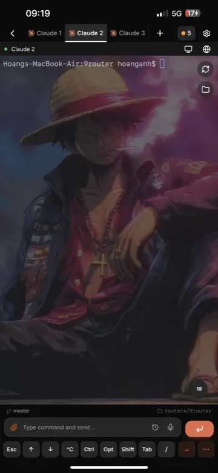
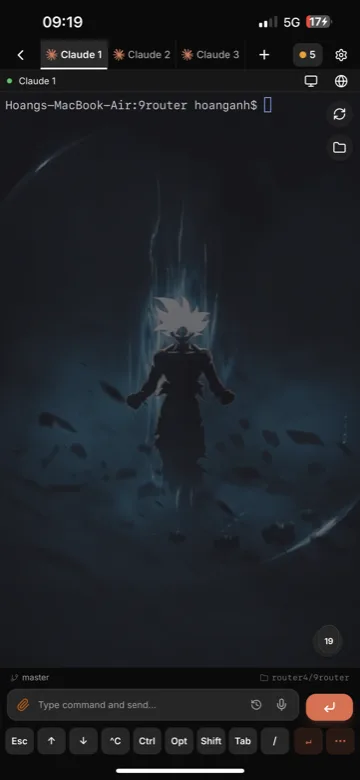
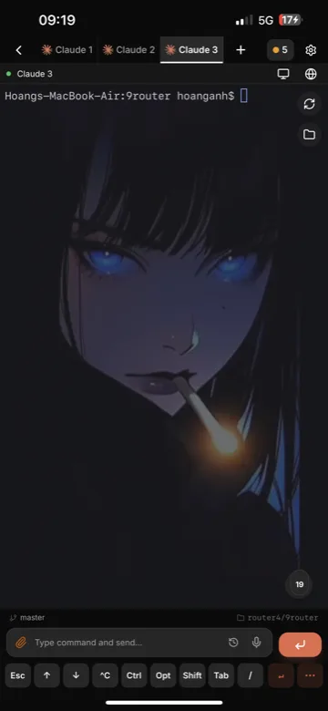
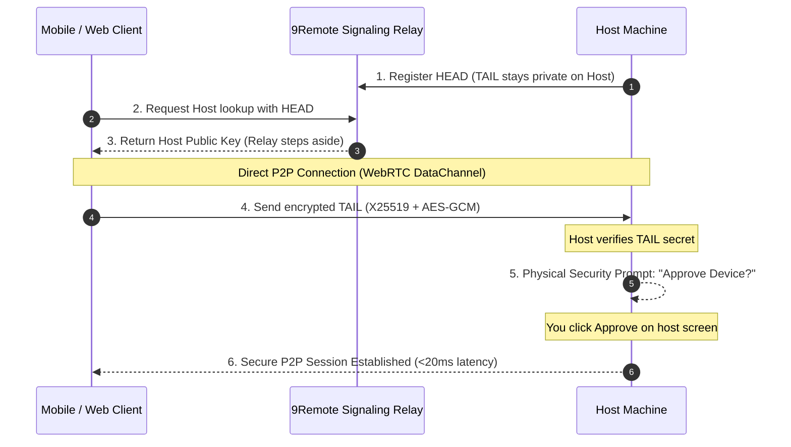

# ARemote — 自托管 Agent 工作区

ARemote 是基于 9Remote（上游 [decolua/9remote](https://github.com/decolua/9remote)）的自托管分支：Client 与 Host 通过**你自己的 Server** 反向中继连接，不再依赖官方云服务——Cloudflare Tunnel / Workers / D1 / TURN / OTA 均已移出运行路径，Phase 1 以 WS 中继为唯一远程承载。

## 组成

| 目录 | 角色 |
| --- | --- |
| `server/` | 自托管中继 Server：HTTP 管理/设备 API、SQLite（设备身份、ACL、一次性配对码）、WS Relay、静态 Web UI |
| `host/aremote/` | Host 反向连接入口（`node host/aremote/index.js register \| start \| rotate`），复用原 PTY / 文件 / Agent 运行时 |
| `shared/relay/` | Host 与 Server 共用的中继协议、帧编码与限界常量 |
| `web/` | 原 Next.js 工作区，静态导出后由 Server 提供；登录页为设备注册与 Host 选择 |
| `client-shell/` | Windows（Tauri 2）与 Android（WebView）客户端薄壳，无原生命令桥接 |

## 快速开始

```bash
git clone -b phase1/self-hosted-relay https://github.com/Ande-ZH/ARemote.git
cd ARemote
cp .env.example .env   # 设置 AREMOTE_DOMAIN 与独立的随机 ADMIN_PASSWORD
docker compose up -d --build
```

- Host 端：`node host/aremote/index.js register`（配对码注册）→ `node host/aremote/index.js start`
- Client 端：浏览器打开 `https://你的域名/login`，注册设备并由管理员授权后进入原工作区

完整步骤、TLS 证书与数据卷说明见[部署文档](docs/phase1/deployment.md)；构建方法见[构建文档](docs/phase1/build.md)。

## 当前状态（Phase 1）

核心链路与本地部署已验证：Server 测试 9/9；Host 真实 PTY / 文件往返 / 敏感路径拒绝 / Server 重启后终端恢复集成测试；真实浏览器端到端（配对授权、终端键入、刷新恢复、Server 重启续用、编辑器保存落盘、无外部请求）；Docker 镜像构建与 Compose 本地可信 CA HTTPS 及凭证/ACL 持久化；CI（server / integration / docker / windows / android）全绿。

尚未完成：Windows / Android 真机安装与使用、公网域名 ACME 签发、跨源部署、弱网长跑与并发规模等平台验收。进度与限制以[验证记录](docs/phase1/validation.md)为准，另见[独立验收复验报告](docs/phase1/acceptance-claude-glm53-recheck.md)。

以下保留上游项目介绍与来源说明；其中官方服务地址、商店链接及 `9remote` 启动命令属于上游产品。ARemote Host 入口为 `node host/aremote/index.js`。

---

# 9Remote — Remote Everything, Vibecode Everywhere

Your entire dev workstation in your pocket. A remote IDE, 60fps desktop stream, visual file explorer, live mobile emulator, zero-config localhost preview, and every AI harness in one UI — Claude Code, Codex, Gemini CLI & 30+ agents — on PC, Web, iPad, or phone.

> **Codex CLI looks like 1995? Claude Code's TUI hurts? Forget them.** Same agents, one UI you'll actually love.

<div align="center">
  

  <table align="center">
    <tr>
      <td></td>
      <td></td>
      <td></td>
    </tr>
  </table>
</div>

---

## ⚡ Quick Start

### 1. Run with npm (Recommended)

```bash
npm i -g 9remote
9remote
```

### 2. Or Download Desktop App

- **macOS (Universal DMG):** [9Remote-macos-universal.dmg](https://github.com/decolua/9remote/releases/latest/download/9Remote-macos-universal.dmg) *(Intel + Apple Silicon, signed & notarized)*
- **Windows (Setup EXE):** [9Remote-windows-x64-setup.exe](https://github.com/decolua/9remote/releases/latest/download/9Remote-windows-x64-setup.exe) *(Installer, x64)*
- **Windows (Portable EXE):** [9Remote-windows-x64-portable.exe](https://github.com/decolua/9remote/releases/latest/download/9Remote-windows-x64-portable.exe) *(Portable, no install)*
- **Linux:** [deb x64](https://github.com/decolua/9remote/releases/latest/download/9Remote-linux-amd64.deb) · [deb arm64](https://github.com/decolua/9remote/releases/latest/download/9Remote-linux-arm64.deb) · [AppImage arm64](https://github.com/decolua/9remote/releases/latest/download/9Remote-linux-arm64.AppImage)

### 3. Or Get Mobile App

- **iOS / iPadOS:** [Download on the App Store](https://apps.apple.com/us/app/9remote/id6796664210)
- **Android:** [Get it on Google Play](https://play.google.com/store/apps/details?id=cc.remote9.app&pli=1)

Scan the QR code from a phone (or open the URL) and you're on your machine's shell — over WebRTC or WebSocket, through an encrypted tunnel that closes when you stop the host.

---

## 📱 Supported Platforms

| Platform | Host (Your Machine) | Client (Anywhere) | Download / Access |
|---|:---:|:---:|---|
| **macOS** | ✅ | ✅ | [Download .dmg](https://github.com/decolua/9remote/releases/latest/download/9Remote-macos-universal.dmg) or `npm i -g 9remote` |
| **Windows** | ✅ | ✅ | [Download .exe](https://github.com/decolua/9remote/releases/latest/download/9Remote-windows-x64-setup.exe) or `npm i -g 9remote` |
| **Linux** | ✅ | ✅ | [Download .deb / .AppImage](https://github.com/decolua/9remote/releases/latest/download/9Remote-linux-amd64.deb) or `npm i -g 9remote` |
| **Web Browser** | — | ✅ | [`https://9remote.cc/login`](https://9remote.cc/login) *(Zero install, any browser)* |
| **iOS / iPadOS** | — | ✅ | [App Store](https://apps.apple.com/us/app/9remote/id6796664210) / Web PWA *(Supports iPad keyboard & trackpad)* |
| **Android** | — | ✅ | [Google Play](https://play.google.com/store/apps/details?id=cc.remote9.app&pli=1) / Web PWA *(Fullscreen dev mode)* |

---

## ✨ 8 Superpowers

1. **Every Harness, One UI:** Run Claude Code, Codex, Gemini CLI, Cursor CLI, Aider & 30+ AI agents in a single UI, with live artifact inspector (HTML, Markdown, Mermaid).
2. **Every Screen, Everywhere:** Seamless across PC, Web, iPad keyboard shortcuts, and mobile touch dev keys (`Esc`, `Tab`, `Ctrl`, `Alt`, arrows).
3. **60fps Remote Desktop:** Ultra-smooth screen streaming with hardware acceleration and <20ms latency over direct WebRTC.
4. **Full Remote IDE:** Multi-pane terminals, integrated code editor with syntax highlighting, visual Git status & diff viewer.
5. **Live Mobile Emulator:** Interactive remote stream for Android Emulator and iOS Simulator straight on your phone.
6. **Zero-Config Localhost Preview:** Built-in Service Worker bridge streams `localhost:3000` to your mobile browser without port forwarding or ngrok.
7. **Visual File Explorer (Path-Jailed):** Fuzzy search files (⌘⇧P), touch drag-and-drop transfers, and file management safely jailed to your workspace.
8. **Persistent PTY Daemon:** Background daemon keeps your shells and long-running builds alive even when switching networks or closing tabs.

---

## 🛡️ Zero-Trust Security Architecture

9Remote uses 3 layers of zero-trust defense:
- **Split-Key Pairing:** The key is split into HEAD and TAIL. The relay server only brokers the handshake with HEAD and never knows your secret TAIL.
- **Direct WebRTC P2P:** Data flows directly device-to-device with X25519 + AES-256-GCM encryption.
- **Physical Host Approval:** New devices cannot connect until you physically click "Approve" on your computer screen.



---

## 📂 What's in here (Monorepo)

- **`host/`** — the Node.js CLI that runs on the machine you want to reach. Serves PTY terminals (daemonized), streams the screen over WebRTC with dirty-tile diffing, and exposes a jailed file explorer. Published to npm as `9remote`.
- **`web/`** — the Next.js client UI + signaling/session API, deployed to Cloudflare Workers (OpenNext) backed by D1. Terminal data does not flow through it — clients connect to the host directly.
- **`desktop/`** — Tauri wrapper around the host for native macOS, Windows and Linux desktop apps.
- **`gitbook/`** — the docs site.

The transport protocol (`host/transport/` and `web/shared/transport/`) is implemented twice, mirrored on both sides — change one, change the other.

---

## 🌐 Self-hosting the web app

The web app runs on Cloudflare Workers and needs a Cloudflare account (the free tier works). Plain-VPS hosting is not supported — the code uses Workers bindings (D1, KV, Durable Objects, R2).

```bash
# 1. Copy the example config and create the resources it references
cp web/wrangler.toml.example web/wrangler.toml
npx wrangler d1 create 9remote
npx wrangler kv namespace create OTA_KV
# fill the printed ids into web/wrangler.toml

# 2. Secrets: copy web/.dev.vars.example → web/.dev.vars, fill in your values,
#    then push them to the Worker
npm run secrets:sync

# 3. Deploy
npm run web:deploy
```

The host itself runs anywhere Node runs — no Cloudflare dependency.

---

## ✍️ Code signing policy

- Release binaries are built by the maintainers from the tagged commit of this repository — a release tag always points at the exact source its binaries were built from.
- **macOS** apps are signed with an Apple Developer ID and notarized.
- **Windows** installers are Authenticode-signed with a certificate from [SignPath Foundation](https://signpath.org) (free code signing for open source).
- The `9remote` npm package is published from this repository by the maintainers.
- A binary whose signature does not match the publishers above, or that cannot be traced to a tag here, did not come from this project — do not run it.

---

## 📄 License

Apache License 2.0 — see [LICENSE](LICENSE). Free to use, modify, and distribute, including commercially. The "9remote" name and branding are not covered by the license.
